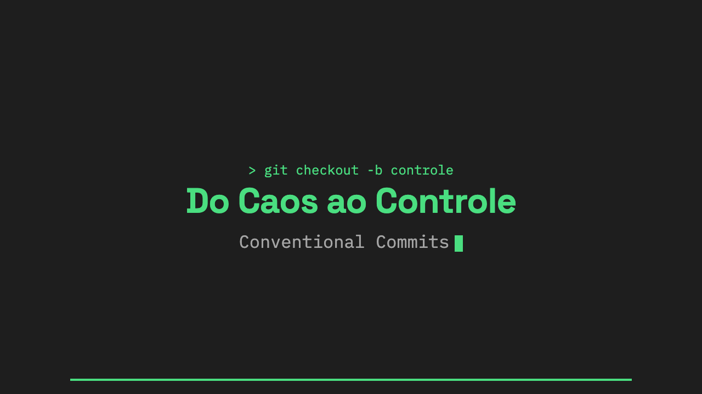

# Do Caos ao Controle: Commits, PRs e contexto no Git

Slides da palestra de **Eduarda Campos** no IWD 2026 (International Women's Day).

**▶ [Ver a apresentação](https://duda-prc.github.io/iwd-2026-eduarda-campos/)**



O código é só metade da história. A outra metade é o contexto: por que aquilo mudou, o que foi decidido, o que ficou de fora.
Esta palestra mostra três hábitos pequenos que guardam esse contexto no Git:

1. **Commits com mensagem clara**: o padrão [Conventional Commits](https://www.conventionalcommits.org/), `git rebase -i` e `git commit --amend`.
2. **Pull Requests com contexto**: o que uma boa descrição tem e como ela ajuda quem revisa.
3. **Uma estratégia de merge consciente**: merge commit, squash and merge ou rebase and merge.

## Aprenda com este repositório

Este repositório também é exemplo. Os PRs dele usam o que os slides ensinam, e cada um entrou na `main` com uma estratégia de merge diferente:

| PR | O que mostra | Slide |
|---|---|---|
| [#1](https://github.com/duda-prc/iwd-2026-eduarda-campos/pull/1) | Descrição com contexto, solução e evidências; entrou com **merge commit** | [26](https://duda-prc.github.io/iwd-2026-eduarda-campos/#26), [29](https://duda-prc.github.io/iwd-2026-eduarda-campos/#29) |
| [#3](https://github.com/duda-prc/iwd-2026-eduarda-campos/pull/3) | **Merge commit**: o PR aparece como um desvio no histórico | [29](https://duda-prc.github.io/iwd-2026-eduarda-campos/#29) |
| [#4](https://github.com/duda-prc/iwd-2026-eduarda-campos/pull/4) | **Squash and merge**: o PR vira um commit só, com `(#4)` no título | [30](https://duda-prc.github.io/iwd-2026-eduarda-campos/#30) |
| [#5](https://github.com/duda-prc/iwd-2026-eduarda-campos/pull/5) | **Rebase and merge**: os commits entram em linha reta, sem commit de merge | [31](https://duda-prc.github.io/iwd-2026-eduarda-campos/#31) |

Para ver o histórico como no slide 33:

```bash
git clone https://github.com/duda-prc/iwd-2026-eduarda-campos.git
cd iwd-2026-eduarda-campos
git log --graph --oneline
```

## Navegação

| Tecla / gesto | Ação |
|---|---|
| `→` `Espaço` `PageDown` / arrastar para a esquerda | Próximo slide |
| `←` `PageUp` / arrastar para a direita | Slide anterior |
| `Home` / `End` | Primeiro / último slide |
| `O` | Índice com todos os slides |
| `F` | Tela cheia |

Cada slide tem endereço próprio: `…/#12` abre direto o slide 12. Dá para mandar o link de um slide específico.
Nos slides com exemplo real, um link **↗** embaixo leva para o PR ou para o histórico deste repositório.

## Rodar localmente

```bash
git clone https://github.com/duda-prc/iwd-2026-eduarda-campos.git
cd iwd-2026-eduarda-campos
python3 -m http.server 8000
```

Abra `http://localhost:8000`. Use um servidor local: abrindo o `index.html` direto do disco, os atalhos de teclado não funcionam com o foco dentro do slide.

## Estrutura

```
index.html           navegação: palco que escala o slide, controles, índice, atalhos
slides/
  slides.js          ordem, título e links "na prática" de cada slide
  slides.css         estilo compartilhado dos slides (1280×720, 16:9)
  01_….html … 37_….html
assets/img/          imagens dos slides (WebP) e a prévia do link (og.png)
```

Cada slide é um HTML de 1280×720. O `index.html` mostra um por vez num iframe e escala para caber em qualquer tela, do celular ao telão.
Para adicionar um slide: crie o HTML em `slides/` e acrescente uma linha em `slides/slides.js`.

**Visual:** fundo `#1E1E1E`, destaque `#4ADE80`, títulos em Space Grotesk e texto em IBM Plex Mono.

## Referências

- [Conventional Commits 1.0.0](https://www.conventionalcommits.org/en/v1.0.0/)
- [Conventional Commits Pattern](https://medium.com/linkapi-solutions/conventional-commits-pattern-3778d1a1e657)
- [Squash, merge, or rebase?](https://mattrickard.com/squash-merge-or-rebase)
- [Difference between git merge, rebase and squash](https://dev.to/ctnkaan/difference-between-git-merge-rebase-and-squash-3kg4)
- [Atlassian Git Tutorials](https://www.atlassian.com/git)

## Licença

Livre para uso pessoal e educacional. Se usar em aula ou palestra, cite a fonte. 💚
